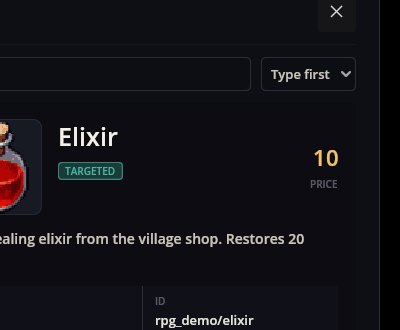

# Items Editor — правка предметов мода в форме

Items Editor правит предметы мода, пока игра работает: названия и описания на всех языках мода, цену, картинку, типы предмета и действие при использовании из инвентаря. **Сохранить** записывает файлы мода, и игра показывает изменение сразу — без перезапуска и перезагрузки.

Открывается из набора инструментов (молоток на панели инструментов) как **Предметы**.

## Правка и её результат в игре

В RPG Plus в инвентаре лежит эликсир из деревенской лавки:

В редакторе: выберите мод `rpg_plus_game` сверху, укажите **Эликсир** в списке, введите новое английское название и нажмите **Сохранить** (Ctrl+S):

Иллюстрация редактора снята раньше: видимые на ней ключи `rpg_demo/` или палитра `rpg_tileset` исторические. Используйте текущие ключи `rpg_plus/` и модель `rpg_object`, описанные в тексте.

Изменилась только английская строка в `locale/en.properties` мода; файл предмета не тронут. Тот же эликсир в инвентаре сразу после:

## Форма

- **Id** — id предмета; по нему находят его сценарии, магазины, карты и другие моды.
- **Название** и **Описание** — ключ перевода и строка на каждый язык мода. Новый предмет получает ключи, составленные из его id; тексты уходят в файлы локализации мода.
- **Цена** — в монетах (магазины могут ставить свои цены).
- **Иконка** — картинка из группы предметов; **…** открывает сетку для выбора.
- **Типы** — Quest, Used, TargetUsed, Food, Resource, Recipe, CantDrop; можно включить несколько.
- **Действие** — что делает использование предмета: `null` или одно из действий предмета, которые регистрируют загруженные моды (`action/heal`, `action/equip`…).
- **Id** сохранённого предмета здесь не меняется напрямую; **Переименовать…** под ним меняет id (см. ниже).
- **Тип экипировки** — пикер: предлагает типы, которые принимают слоты экипировки, ничего не вводится вручную.
- **Поля других модов** — поля, которые другие моды описывают в своих схемах для предметов (например, тип экипировки, черты и доступные классы из Equipment), появляются отдельной секцией с такими же редакторами.
- **Прочие поля** — всё остальное из JSON предмета, показывается и правится как JSON; сохраняется как есть.

Панель инструментов: **Новый** (Ctrl+N) добавляет `<mod>/new_item` — ресурс ценой в одну монету без действия; **Копия** (Ctrl+D), **Удалить**, **Отменить**/**Повторить** (Ctrl+Z / Ctrl+Y). Сохранение пишет только файлы, где изменился текст; новый предмет попадает в `items/<mod>.json`.

## Предметы других модов

Список показывает предметы выбранного мода. Отметьте **Entries of other mods**, чтобы добавить предметы его зависимостей; они помечены `↗ владелец`. Правка такого предмета не трогает файл владельца: изменение сохраняется патчем в вашем моде (`patches/item/<ваш мод>.json`), где только изменённые значения. **Reset to inherited** убирает патч, **Delete** пишет `$delete`, **Copy** создаёт свой предмет с новым id. Писать можно только в моды, установленные папкой.

Каждое поле показывает, откуда его значение: значок отмечает ваш патч, патч другого мода или значение, унаследованное через `Extends`; кнопка **↺** убирает ваше значение поля, и возвращается унаследованное.

## Переименование id

**Переименовать…** появляется под Id сохранённого предмета. Оно спрашивает новый id, а **Показать изменения** перечисляет файлы, которые изменятся, до записи:

- собственный файл предмета и все файлы мода, где он назван (рецепты, магазины, расстановки, сценарии, добыча персонажей), переписываются с новым id;
- файлы других модов, где назван предмет, только перечисляются: они не меняются, и после переименования те моды перестанут находить предмет.

**Переименовать** сначала сохраняет несохранённые правки, затем пишет перечисленные файлы; игра сразу знает новый id. **Отменить переименование** на панели возвращает каждый изменённый файл точно таким, каким он был. Id состоит из латинских букв, цифр, `_`, `-` и `/` между частями и должен быть свободен во всех модах. Ссылка, которой нет в схемах (значение, которое сценарий собирает во время игры, или текст в коде), не находится: такие места проверьте вручную.

## Поставить на карту

Кнопка **Place on map** открывает RPG Map Editor на первом файле карты мода предмета, с выбранным объектом-подбором. Подбор — объект категории `pickup`, чей id заканчивается именем предмета: для `rpg_plus/amber` это `rpg_plus/pickup/amber`. Если у предмета ещё нет объекта-подбора, редактор записывает его в мод предмета (`objects/pickup_<имя>.json`, id `<мод>/pickup/<имя>`) с картинкой предмета и сразу выбирает его. Нужны картинка предмета и имя из строчных латинских букв, цифр и подчёркивания; иначе строка состояния скажет, что не так. Карта вписывается в окно целиком. Кликните клетку, чтобы поставить подбор, и задайте его Interact в редакторе карт, чтобы он давал предмет.

Картинка нового подбора копируется из группы предметов в `rpg_images/<мод>/pickup/<имя>.<расширение>` того же мода. Копия побайтно сохраняет исходник; картинка инвентаря не меняется. Объект ссылается на эту отдельную картинку карты, поэтому его можно отрисовать и проверить в обеих проекциях. Существующий отличающийся файл не перезаписывается: редактор сообщит о конфликте. Если запись объекта не завершилась, новая копия удаляется.

Редактор карт не добавляет взаимодействие к предмету автоматически. Выберите размещение, затем **Взаимодействие → Что делает → Даёт предмет**, укажите предмет и количество и сохраните. В командах события также можно написать `action item.add id=<item> count=1`. Для одноразового подбора добавьте сохраняемый флаг и состояние либо условие события: один выбор «Даёт предмет» повторяет награду при каждом использовании.

## Если что-то пошло не так

1. **Список модов пуст.** Ни в один мод нельзя писать; упакованные моды не редактируются.
2. **В инвентаре всё ещё старое название.** Предмет сохранён на другом языке, а не на языке игры; проверьте строку языка игры.
3. **В списке действий нет действия.** Мод, который его регистрирует, в эту игру не загружен.

## Размеры в инвентаре

В форме предмета доступны ширина и высота в ячейках, размеры группы, предел количества и поворот (0 или 1). Нулевые размеры группы наследуют размеры предмета. Предел 1 запрещает объединение. Поля записываются в блок Inventory, сохраняя остальные данные. Уже сохранённые группы сохраняют свои размеры.
