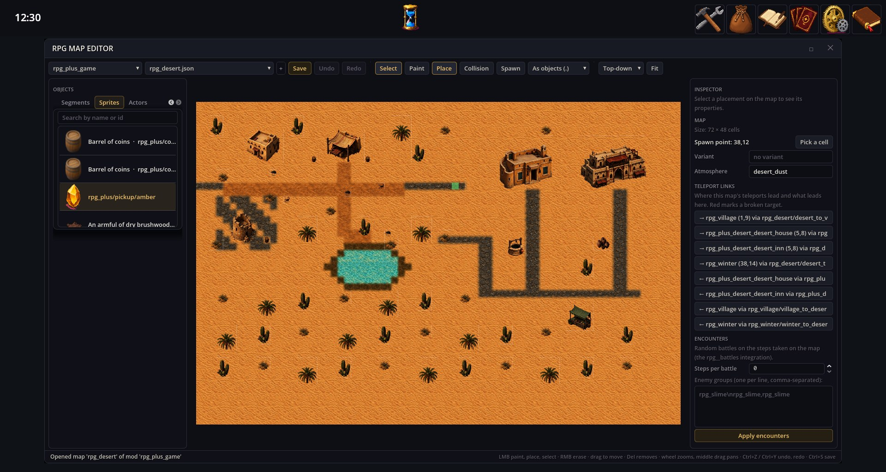

# Items Editor — sửa vật phẩm của mod bằng biểu mẫu

Items Editor sửa các vật phẩm của một mod khi game đang chạy: tên và mô tả bằng mọi ngôn ngữ của mod, giá, hình ảnh, loại vật phẩm và hành động khi dùng từ túi đồ. **Lưu** ghi các tệp của mod và game hiện thay đổi ngay — không cần khởi động lại, không cần tải lại.

Nó mở từ hộp công cụ (chiếc búa trên thanh công cụ) dưới tên **Vật phẩm**.

## Một chỉnh sửa và kết quả trong game

Trong RPG Plus, túi đồ có thuốc tiên của cửa hàng trong làng:

Trong trình sửa: chọn mod `rpg_plus_game` ở trên, chọn **Thuốc tiên** trong danh sách, gõ một tên tiếng Anh mới rồi nhấn **Lưu** (Ctrl+S):

Chỉ dòng tiếng Anh trong `locale/en.properties` của mod thay đổi; tệp vật phẩm không bị đụng tới. Cùng chai thuốc tiên trong túi đồ ngay sau đó:

## Biểu mẫu

- **Id** — id của vật phẩm; kịch bản, cửa hàng, bản đồ và mod khác tìm nó qua id này.
- **Tên** và **Mô tả** — khóa dịch và một dòng cho mỗi ngôn ngữ của mod. Vật phẩm mới nhận các khóa tạo từ id của nó; văn bản được ghi vào tệp bản địa hóa của mod.
- **Giá** — tính bằng đồng xu (cửa hàng có thể tự đặt giá).
- **Biểu tượng** — một hình trong nhóm vật phẩm; **…** mở lưới để chọn.
- **Kiểu** — Quest, Used, TargetUsed, Food, Resource, Recipe, CantDrop; có thể bật nhiều cái.
- **Hành động** — dùng vật phẩm thì chuyện gì xảy ra: `null` hoặc một trong các hành động vật phẩm mà các mod đã tải đăng ký (`action/heal`, `action/equip`…).
- **Trường của mod khác** — những trường mà mod khác mô tả trong lược đồ của họ cho vật phẩm (ví dụ kiểu trang bị, đặc tính và lớp được phép của Equipment) hiện trong mục riêng với cùng loại trình sửa.
- **Các trường khác** — mọi thứ còn lại trong JSON của vật phẩm, hiện và sửa dưới dạng JSON; được giữ nguyên như cũ.

Thanh công cụ: **Mới** (Ctrl+N) thêm `<mod>/new_item` — một tài nguyên giá một đồng xu, không có hành động; **Sao chép** (Ctrl+D), **Xóa**, **Hoàn tác**/**Làm lại** (Ctrl+Z / Ctrl+Y). Lưu chỉ ghi những tệp có văn bản thay đổi; vật phẩm mới vào `items/<mod>.json`.

## Vật phẩm của mod khác

Danh sách hiển thị vật phẩm của mod đã chọn. Đánh dấu **Entries of other mods** để thêm vật phẩm của các mod phụ thuộc, có ghi `↗ chủ sở hữu`. Sửa vật phẩm như vậy không đụng đến tệp của chủ sở hữu: thay đổi được lưu thành bản vá trong mod của bạn (`patches/item/<mod của bạn>.json`), chỉ chứa các giá trị đã đổi. **Reset to inherited** xóa bản vá, **Delete** ghi `$delete`, **Copy** tạo vật phẩm riêng với id mới. Chỉ ghi được vào các mod được cài đặt dưới dạng thư mục.

Mỗi trường cho biết giá trị của nó đến từ đâu: huy hiệu đánh dấu giá trị là bản vá của bạn, bản vá của mod khác, hay giá trị kế thừa qua `Extends`; nút **↺** xóa giá trị của bạn ở trường đó và giá trị kế thừa trở lại.

## Đặt lên bản đồ

**Place on map** mở Trình chỉnh sửa bản đồ RPG trên tệp bản đồ đầu tiên của mod chứa vật phẩm, với vật thể nhặt của vật phẩm đã được chọn sẵn để đặt. Vật thể nhặt là vật thể thuộc loại `pickup` có id kết thúc bằng tên vật phẩm: với `rpg_plus/amber` là `rpg_plus/pickup/amber`. Nếu không có, vật thể nhặt đầu tiên của trò chơi được chọn, nên hãy kiểm tra lựa chọn trong bảng của trình sửa bản đồ.

Trình sửa bản đồ không ghi tương tác. Vật thể nhặt đã đặt chỉ trao vật phẩm khi vị trí của nó có hành động `item.add id=<vật phẩm> count=1`; dòng này phải tự viết trong tệp của vị trí.

## Khi có trục trặc

1. **Danh sách mod trống.** Không có mod nào ghi được; mod đóng gói không sửa được.
2. **Túi đồ vẫn hiện tên cũ.** Vật phẩm được lưu bằng ngôn ngữ khác ngôn ngữ của game; hãy kiểm tra dòng của ngôn ngữ game.
3. **Danh sách hành động thiếu một hành động.** Mod đăng ký nó chưa được tải trong game này.
