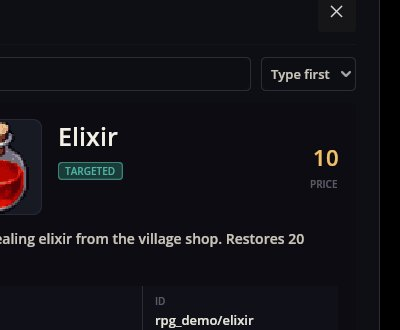
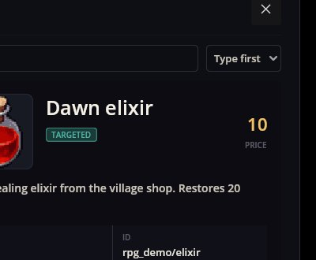

# Items Editor — 用表单编辑模组的物品

Items Editor 在游戏运行时编辑模组的物品：各种语言的名称和描述、价格、图片、物品类型，以及从背包使用时的动作。**保存**会写入模组的文件，游戏立刻显示变化——无需重启，无需重新加载。

它从工具箱（工具栏上的锤子）打开，叫**物品**。

## 一次编辑及其在游戏中的结果

RPG Plus 的背包里有村里商店卖的药水：

在编辑器里：顶部选择模组 `rpg_demo_game`，在列表中选**药剂**，输入新的英文名称，按**保存**（Ctrl+S）：

只有模组 `locale/en.properties` 的英文一行变了；物品文件没有动。紧接着背包里的同一瓶药水：

## 表单

- **Id** —— 物品的 id；剧本、商店、地图和其他模组都靠它找到物品。
- **名称**和**描述** —— 翻译键和模组每种语言的一行文字。新物品会得到由 id 组成的键；文字写入模组的本地化文件。
- **价格** —— 以金币计（商店可以自己定价）。
- **图标** —— 物品组的一张图片；**…** 打开网格挑选。
- **类型** —— Quest、Used、TargetUsed、Food、Resource、Recipe、CantDrop；可以同时勾选多个。
- **动作** —— 使用物品时做什么：`null` 或已加载模组注册的某个物品动作（`action/heal`、`action/equip`…）。
- **其他模组的字段** —— 其他模组在各自模式中为物品描述的字段（例如 Equipment 的装备类型、特性和可用职业），会在单独区域以同样的编辑器出现。
- **其他字段** —— 物品 JSON 里的其余内容，按 JSON 显示和编辑；原样保留。

工具栏：**新建**（Ctrl+N）添加 `<mod>/new_item`——一个价值一枚金币、没有动作的资源；**复制**（Ctrl+D）、**删除**、**撤销**/**重做**（Ctrl+Z / Ctrl+Y）。保存只写文字有变化的文件；新物品进入 `items/<mod>.json`。

## 哪些物品可以编辑

列表显示一个模组的物品——即它自己文件里的那些。模组列表里只有以文件夹安装的模组。想不改那个模组就改它的物品，可以在你的模组里带上相同的 id 并声明对属主的依赖；Items Editor 本身只编辑所选模组的文件。

## 出问题了怎么办

1. **模组列表是空的。** 没有可写的模组；打包模组不能编辑。
2. **背包里还是旧名字。** 物品保存所用语言与游戏语言不同；检查游戏语言那一行。
3. **动作列表里缺一个动作。** 注册它的模组没有在这个游戏里加载。
